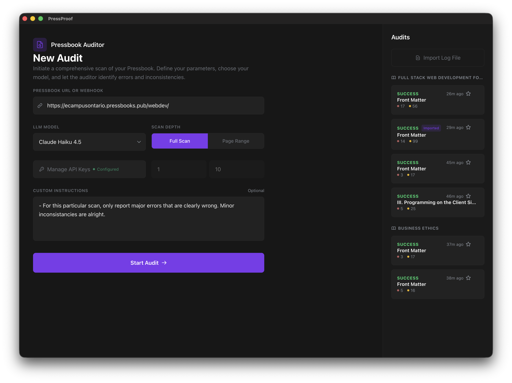
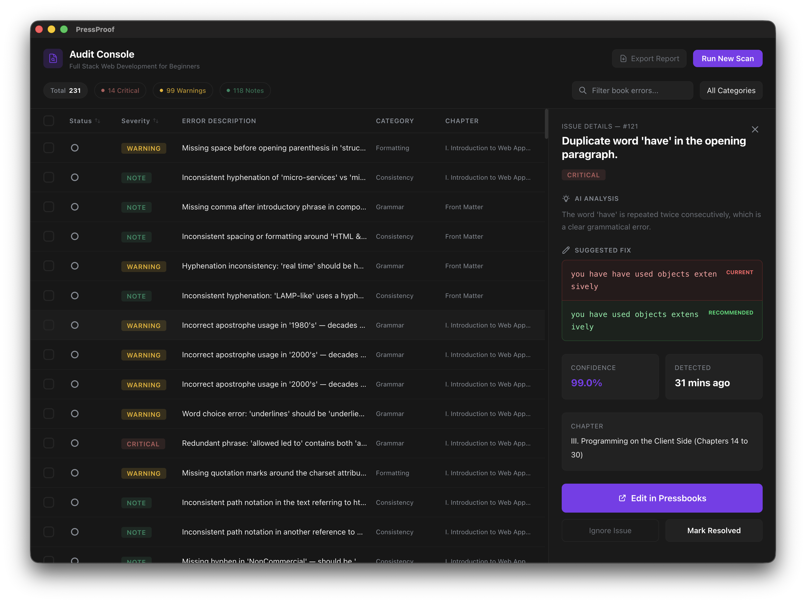

# PressProof

An open source proofreading tool designed for proofreading pressbook books. Given the base url of any book, PressProof automatically crawls through each page, extracting text, and identifying errors using your LLM of choice (Currently restricted to OpenAI and Claude models). The tool then displays each issue along with a short description, the suggested fix, confidence, and severity.  

## Setup and Usage
Download the respective build for your operating system from the latest PressProof release. Upon launching the app, you will be given the option to create a new audit. Before we can do so, please first navigate to `Manage API Keys` and add the respecive API keys needed for your LLM of choice. After doing so, you can simply provide the [base URL](https://ecampusontario.pressbooks.pub/businessfuncdn/) to any PressBook in order to begin an audit. Note that you can select the page range as well as provide extra instructions to the LLM for the scan (keep minimal to preserve context).

### Mode;s
Pressproof now offers a range of models from both OpenAI and Claude, each with their own benefits as detailed below. 


| Company | Model | Description | Cost | Recommended |
| :--: | :--: | :-- | :--: | :--: |
| OpenAI | GPT-4o | Great for extensive proof reads but is significantly more expensive. Ideally used for final extensive proof reads. | $$ |  |
| OpenAI | GPT-4o Mini | Works well and is extremely cost effective however, it may not be as thourough as the non-mini model. | $ | |
| Claude |  Sonnet 4.6 | Proved to provide higher level of detail in comparison to OpenAI models however, this model was significantly more expensive to run in comparison to GPT-4o  | $$$ | |
| Claude | Haiku 4.5 | Proved to provide higher level of detail in comparison to OpenAI models while still remaining as cost effective as GPT-4o Mini | $ | ⭐ |

### Exporting/Importing Audits
PressProof importing and exporting audits. In order to export an audit, open it inside PressProof, and select "Export Audit". This will export the audit as a JSON file which can be imported via the import button located on the top right of the home page. Note that the JSON also maintains changes to the status of each issue.  

## Build PressProof
Running and building the app from source can be done like so.

```bash
cd pressproof
```

```bash
#Building app from source
npm install .
npm run dev
```


```bash
#Build distributables for macOS and Windows
npm run build:mac
npm run build:win
```

## Legacy CLI Tool
PressProof was originally a command line tool which can now be found here. Although the feature set and functionality is similar, the CLI version does not have some of the performance and accuracy improvements that this version has.